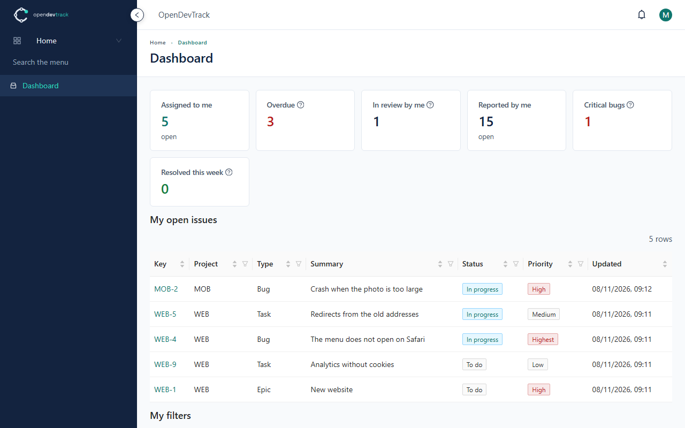

# User guide

How to work with OpenDevTrack: projects, issues, boards, search, dashboards and notifications. It is written for the
people who use the tracker. Installing and running it is the [administrator guide](../admin/README.md).

The screens come in English and Italian, and this guide uses their English labels. The images are taken from
[`stack/`](../../stack/README.md) with its sample projects, signed in as `mario.rossi`.

| Page | What |
| --- | --- |
| [Projects and members](projects.md) | Projects, their members and roles, groups, permission schemes |
| [Issues](issues.md) | Issues, custom fields, comments and mentions, attachments, links, watchers, history |
| [Workflows](workflows.md) | Statuses, transitions and their conditions, one workflow per issue type |
| [Boards, backlog and sprints](boards.md) | Kanban and scrum boards, the backlog as a table by sprint, planning and completing sprints |
| [Search and ODQL](search.md) | The search screen, saved filters and the full reference of the query language |
| [Dashboards and reports](dashboards.md) | Your dashboard, the dashboard of a project and its charts |
| [Notifications](notifications.md) | The bell, mail at once or in a daily summary, and your choices |
| [Your data and your sessions](your-data.md) | What OpenDevTrack keeps about you, and where you are signed in |
| [The public API and webhooks](api.md) | Working with OpenDevTrack from a program |

## Signing in

OpenDevTrack has no sign-in page of its own. Opening it takes you to the sign-in page of the organisation (Keycloak),
with the user name and password your administrator gave you. Some installations also ask for a code from an
authenticator app. Passwords are managed there too: where the installation allows it, «Forgot password?» on that page
sends a link to reset yours.

When you belong to more than one organisation (a *tenant*, called «Workspace» in the screens), the user menu at the
top right starts with the list of your workspaces, to switch between them. Each tenant has its own projects, users
and settings, and you see the work of one at a time.

## The screen

- **The side bar** shows the items of one area. The area is chosen at the top of the side bar:
  - **Home**: your dashboard;
  - **Projects**: all projects, the boards and the search;
  - **Administration**: shown only to administrators ([administrator guide](../admin/administration.md)).

  «Search the menu» finds an item by its name, and the arrow next to the logo folds the side bar.
- **The bell** shows your messages: mentions, assignments, reviews asked, comments and status changes
  ([Notifications](notifications.md)).
- **The user menu** (your initial) switches the workspace, opens the settings and signs out. The settings have four
  tabs:
  - «General»: the language (English or Italian) and the theme (light or dark);
  - «Notifications»;
  - «Your sessions»;
  - «Your data».

Every screen has its own address, so a link to an issue, a board or a search with its query can be shared with
anyone who may see it.

## What you may do

What you see depends on your roles:

- **In the tenant.** «Member» lets you see the projects you belong to. «Project creator» adds «New project». «Admin of
  the projects» makes you admin of every project of the tenant, and of its groups and permission schemes. «Admin of
  the users» manages the users and their roles. These roles are given in the Administration area.
- **In each project.** Viewer, developer or admin ([Projects and members](projects.md)).

A button you may not use is not shown. A screen you may not open says so.
