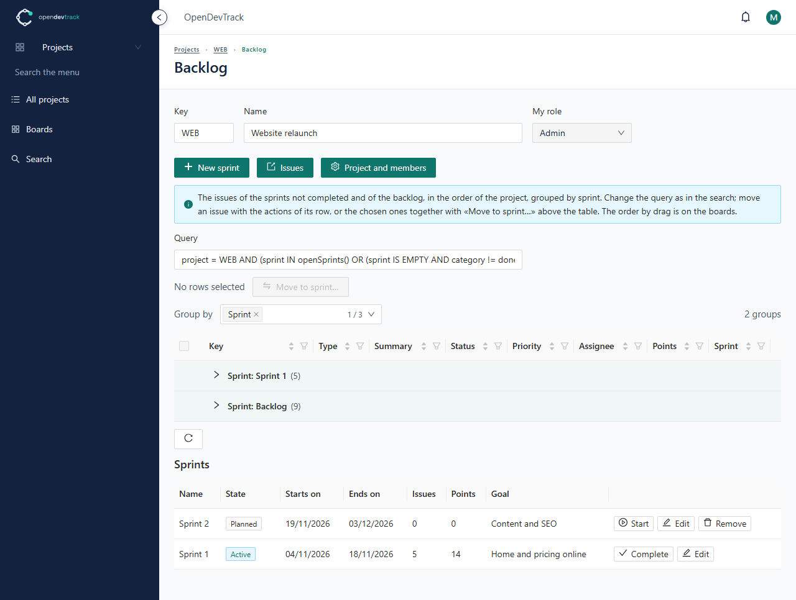

# Boards, backlog and sprints

The issues of a project are in one order, the order of the project. The backlog shows that order and plans issues in
sprints. The boards show the work by status.

## Boards


Projects › Boards lists the boards of your projects. A project has at least one board, and its admins add others in
the tab **Boards** of the project («New board»):

| Field | What |
| --- | --- |
| Board | Its name |
| Kind | **Kanban**: every issue of the project, except those done more than 14 days ago. **Scrum**: the issues of the active sprint |
| Lanes by | None, Assignee, Priority or Type: one row of the board for each value |
| Columns | One column per status, when empty. Otherwise one line per column, below |
| Filter | An ODQL query: only the issues it finds are cards ([Search and ODQL](search.md)). Empty for every issue |

The columns are written one per line as `Name: status, status | limit`:

```
To do: todo
Doing: in_progress, review | 3
Done: done
```

Each status of the workflow goes in at most one column. The limit is optional: the header of a column shows how many
cards it holds against its limit (`3/3`), and a column over its limit is marked. The limit does not stop a move.
A status that no column names shows in the first column of its category, or else in the last one.

A filter makes a board for one team or one theme: `labels = payments`, or `assignee = currentUser()` for a board
that shows each user their own cards. The board says when it has a filter.

### Moving cards


- **To another column**: the issue goes through a transition of the workflow, the first one that leads to a status of
  that column and can run now. When none can, the card goes back and the board says why
  ([Workflows](workflows.md#conditions)).
- **Up or down in its column**: the issue changes its place in the order of the project.
- **To another row**, on a board with lanes by assignee, priority or type: the issue takes the assignee, the priority
  or the type of that row («No group» takes the assignee away). The board asks first, for example «The assignee will
  be changed to luisa. Move the card?»; the change follows the rules of the issue form (an assignee who is a member and
  not the reviewer, the custom fields a new type requires) and, when the card also goes to another column, the
  transition sees the issue as changed: either both happen or neither. The «Move» menu of a card has the other rows
  under «Move to row».

A card shows the summary, the key, the type and priority, the story points and the initial of the assignee; a flagged
issue ([Issues](issues.md#flag-and-votes)) stands out with a yellow edge and the flag, also in the backlog. Clicking
the summary opens the issue. Moving cards needs the role of developer or admin.

## The backlog



«Backlog» (from the issues or from the project) is a search ([Search](search.md)) that opens with the query

```
project = WEB AND (sprint IN openSprints() OR (sprint IS EMPTY AND category != done)) ORDER BY rank
```

the issues of the sprints not completed, and those not done that are in no sprint, in the order of the project. The
table groups them by sprint: the active sprint first, then the planned ones, then the backlog. Change the query, sort,
filter and group as in the search; «Group by» without «Sprint» shows the plain order.

Each row has three actions, for developers and admins:

- **Move to sprint…**: pick a sprint not completed of the project, or «Backlog» to take the issue out of its sprint.
- **To the top** and **To the bottom**: the issue goes first or last in the order of the project.

To plan several issues at once, tick their rows (also on other pages and in other groups) and use **Move to sprint…**
above the table: they all go into the sprint you pick, or back to the backlog. It works on the issues of the project of
the backlog; with rows of other projects chosen, it stays off.

To put an issue between two others, drag its card on a board: a board and the backlog share the one order of the
project.

The story points and the sprint of an issue are also set on the issue, under «Planning».

## Sprints

The table **Sprints** under the backlog has the sprints of the project with their state, dates, issues and points.
Developers and admins manage them:

- **New sprint**: a name (empty for the next number, «WEB Sprint 3»), a goal, and the dates. A project has at most
  9 sprints not completed.
- **Start**: one sprint is active at a time. Empty dates start it today and end it two weeks later. What it holds
  when it starts is what the burndown and the velocity measure.
- **Complete**: the issues not done go to the backlog, to the next planned sprint, or to a sprint you pick.
- **Edit**: the name, the goal and the dates.
- **Remove**: only a planned sprint. Its issues go back to the backlog.

A scrum board shows the active sprint. With no active sprint, it says so: start one from the backlog.
