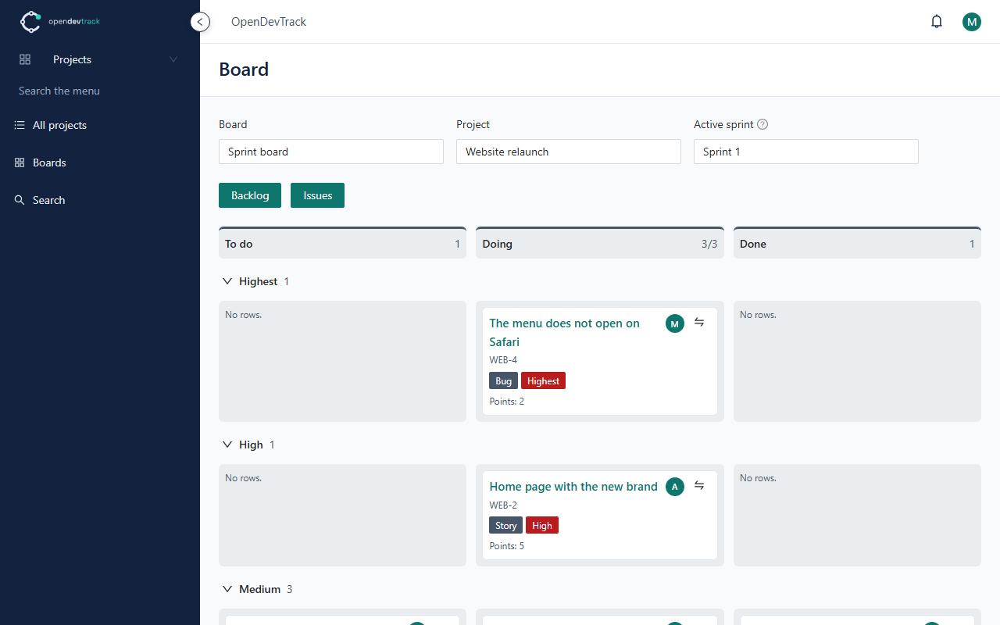
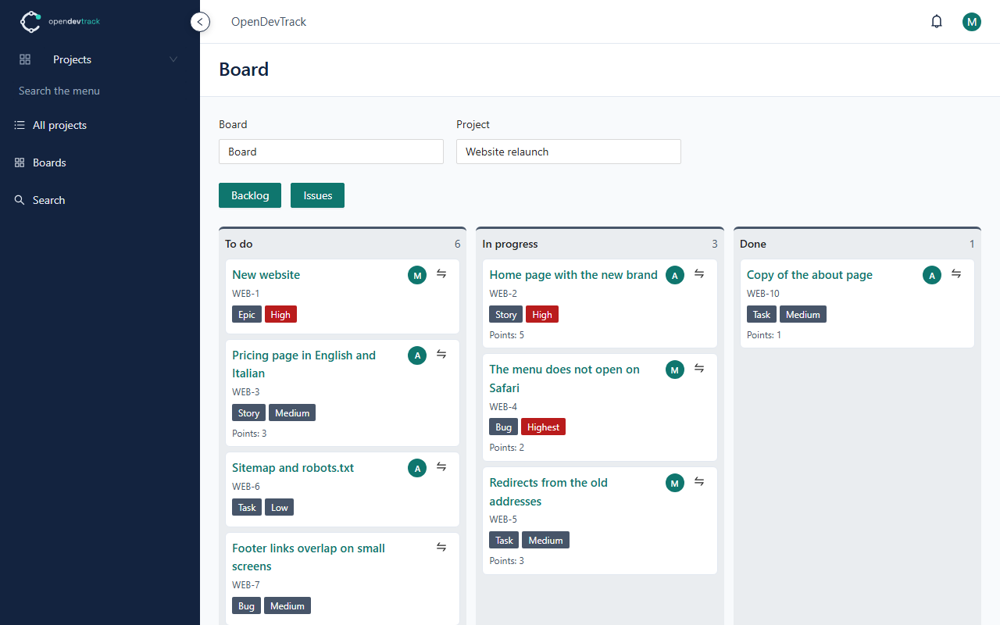

# Boards, backlog and sprints

The issues of a project are in one order, the order of the project. The backlog shows that order and plans issues in
sprints. The boards show the work by status.

## Boards



Projects › Boards lists the boards of your projects. A project has at least one board, and its admins add others in
the table **Boards** of the project («New board»):

| Field | What |
| --- | --- |
| Board | Its name |
| Kind | **Kanban**: every issue of the project, except those done more than 14 days ago. **Scrum**: the issues of the active sprint |
| Lanes by | None, Assignee, Priority or Type: one row of the board for each value |
| Columns | One column per status, when empty. Otherwise one line per column, below |
| Filter | An ODQL query: only the issues it finds are cards ([Search and ODQL](search.md)). Empty for every issue |

The columns are written one per line as `Name: status, status | limit`:

```
To do: todo
Doing: in_progress, review | 3
Done: done
```

Each status of the workflow goes in at most one column. The limit is optional: the header of a column shows how many
cards it holds against its limit (`3/3`), and a column over its limit is marked. The limit does not stop a move.
A status that no column names shows in the first column of its category, or else in the last one.

A filter makes a board for one team or one theme: `labels = payments`, or `assignee = currentUser()` for a board
that shows each user their own cards. The board says when it has a filter.

### Moving cards



- **To another column**: the issue goes through a transition of the workflow, the first one that leads to a status of
  that column and can run now. When none can, the card goes back and the board says why
  ([Workflows](workflows.md#conditions)).
- **Up or down in its column**: the issue changes its place in the order of the project.

A card shows the summary, the key, the type and priority, the story points and the initial of the assignee. Clicking
the summary opens the issue. Moving cards needs the role of developer or admin.

## The backlog


«Backlog» (from the issues or from the project) shows one column for each sprint not completed, the active one first,
and then the backlog: the issues not done that are in no sprint.

- Dragging an issue onto a sprint plans it in that sprint, and dragging it onto the backlog takes it out.
- Dragging it up or down changes its place in the order of the project.

The story points and the sprint of an issue are also set on the issue, under «Planning».

## Sprints

The table **Sprints** under the backlog has the sprints of the project with their state, dates, issues and points.
Developers and admins manage them:

- **New sprint**: a name (empty for the next number, «WEB Sprint 3»), a goal, and the dates. A project has at most
  9 sprints not completed.
- **Start**: one sprint is active at a time. Empty dates start it today and end it two weeks later. What it holds
  when it starts is what the burndown and the velocity measure.
- **Complete**: the issues not done go to the backlog, to the next planned sprint, or to a sprint you pick.
- **Edit**: the name, the goal and the dates.
- **Remove**: only a planned sprint. Its issues go back to the backlog.

A scrum board shows the active sprint. With no active sprint, it says so: start one from the backlog.
