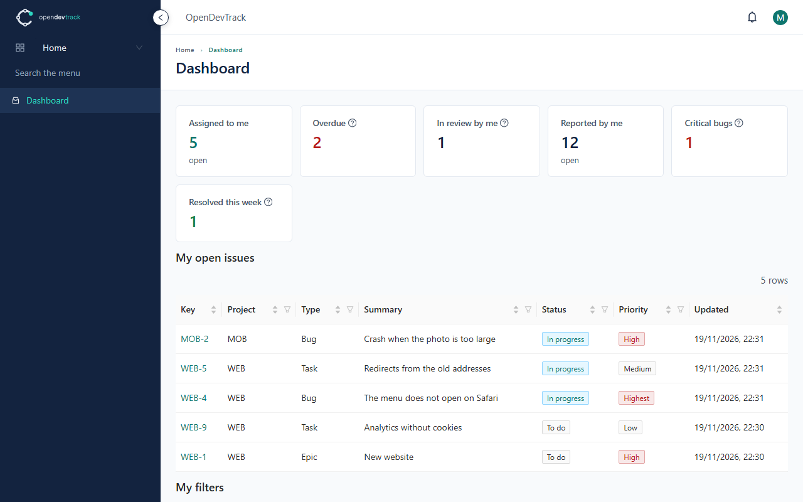
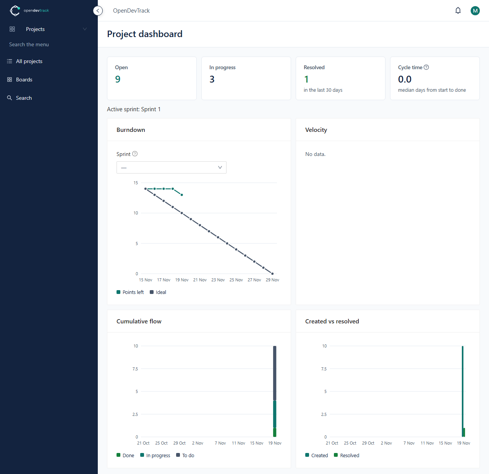

# Dashboards and reports

## Your dashboard

Home › Dashboard is the first screen after signing in. It counts, across your projects:

| Indicator | What |
| --- | --- |
| Assigned to me | Your open issues |
| Overdue | Your open issues past their due date |
| In review by me | Issues in progress whose reviewer you are |
| Reported by me | Open issues you reported |
| Critical bugs | Open bugs with the highest priority in your projects |
| Resolved this week | Issues of your projects resolved since Monday |

Below them:

- **My open issues**: your open issues, which you can sort and filter. A key opens the issue.
- **My filters**: your saved filters marked «On my dashboard» in the search, with the number of issues each one finds
  now ([Search and ODQL](search.md#saved-filters)).

## The dashboard of a project

«Dashboard», on the screen of a project, opens its reports. Every member of the project sees them.

| Report | What |
| --- | --- |
| Open, In progress | The issues of the project not done, and those in a status of the category In progress |
| Resolved | The issues resolved in the last 30 days |
| Cycle time | The median number of days from start to done, of the issues resolved in the last 30 days that went through a status in progress |
| Burndown | The story points left in a sprint, day by day, against the ideal line. «Sprint» picks one, and empty means the active sprint, or else the last one |
| Velocity | The points committed at the start and the points done, for the last six completed sprints |
| Cumulative flow | The issues per status category, day by day, for the last 30 days |
| Created vs resolved | The issues created and resolved each day, for the last 30 days |

The days are counted in the time zone of the installation. The reports are updated a moment after each change, and
once every night for the days with no change.
