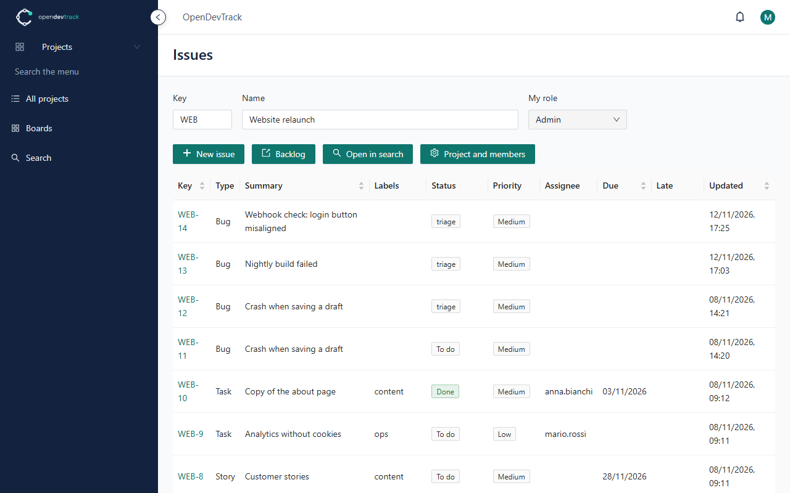
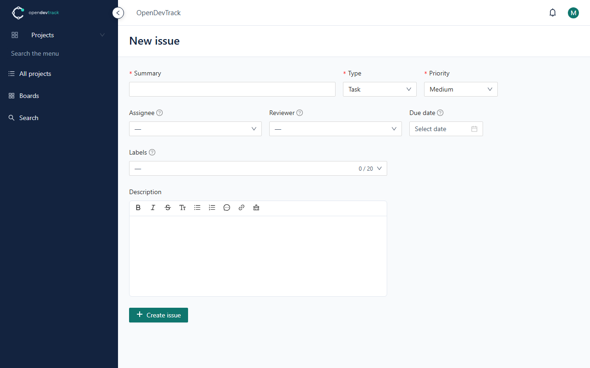
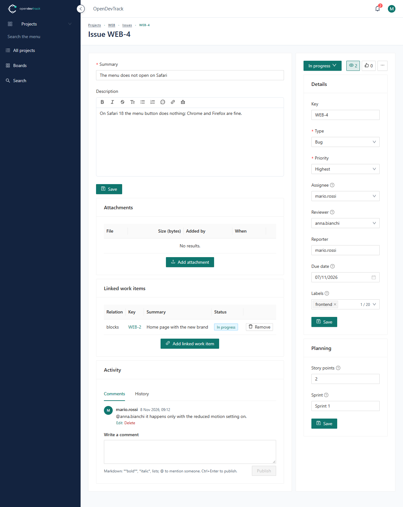

# Issues

An issue is one piece of work of a project: a task, a bug, a story or an epic. Its key is the key of the project and
a number (`WEB-4`), and it never changes.

## The list of a project



«Issues», from the list of projects or from a project, shows the issues of that project, the most recently updated
first. Sorting by a column is done from its header. «Late» shows «Overdue» for an issue past its due date and not
done.

The buttons:

- «New issue»: create an issue;
- «Backlog»: plan the issues in sprints ([Boards, backlog and sprints](boards.md));
- «Open in search»: the same issues in the search, where any condition can be added ([Search and ODQL](search.md));
- «Project and members»: the project.

## A new issue



Developers and admins of the project create issues. The fields:

| Field | What |
| --- | --- |
| Summary | One line: what it is about. Required |
| Type | Task, Bug, Story or Epic. Required |
| Priority | Lowest, Low, Medium, High or Highest. Required |
| Assignee | The member who does it |
| Reviewer | The member who checks it: not the assignee |
| Due date | The day it should be done. Past it, and not done, the issue is overdue |
| Labels | Words that group issues across types: lower-case letters, digits, dots, dashes and underscores. Enter or a comma adds one, and the labels already used in the project are suggested |
| Description | Text with simple formatting (Markdown), from the toolbar of the field: bold, italic, lists, links |

The custom fields of the project come after these ([below](#custom-fields)). A new issue starts in the first status
of its workflow ([Workflows](workflows.md)).

## An issue



The screen of an issue has two columns; on a phone the right one comes below the left one.

On the left is what the issue says and what happened to it:

- its **summary** and **description**, which the developers and admins change and save with «Save»;
- **Attachments**: the files of the issue ([below](#attachments));
- **Linked work items**: the other issues it is linked to; «Add linked work item», under them, adds one ([below](#links));
- **Activity**: its comments and its history.

On the right is what describes it:

- the **status** button at the top, coloured by the category of the status (grey to do, blue in progress, green done).
  Its menu lists the statuses the issue can move to now, as badges: choosing one runs that transition. A transition
  with a condition that is not met is not listed. «View workflow» shows the workflow of the issue as a graph, with
  its statuses, the transitions between them and the current status outlined;
- next to it, a red flag while the issue is flagged (developers and admins remove the flag with it), then the eye
  with the number of people watching the issue, highlighted while you watch it: its menu
  has «Watch» or «Stop watching», and «Watchers», a window with who is watching it ([below](#watchers));
- the thumb with the number of votes, highlighted when you voted: it adds your vote or takes it back;
- «…», more actions: «Add flag» or «Remove flag», «Add vote» or «Remove vote» ([below](#flag-and-votes)), «All issues»,
  and «Delete», for the admins of the project. Delete cannot be undone, and the
  comments, attachments and links of the issue go with it;
- **Details**: its key, type, priority, assignee, reviewer, reporter, due date, labels and custom fields,
  saved with their own «Save»;
- **Planning**: its story points (0 to 999, empty when not estimated) and the sprint it is planned in, with their own
  «Save».

Each «Save» saves only its own box, and shows the issue again as saved. If someone else saved the issue in the
meantime, saving says so: reload it and make the change again, so that no change is lost.

### Comments and mentions

Every member sees the comments, and the developers and admins write them. A comment takes the same simple formatting
as the description, and Ctrl+Enter publishes it.

Typing `@` offers the members of the project: a comment that names one with `@username` *mentions* them. They get a
message ([Notifications](notifications.md)) and start watching the issue. A name that is not a member stays plain
text, and so does an email address.

The author edits and deletes their comments. An edited comment is marked as such, and only the people mentioned for
the first time are told. The admins of the project also delete the comments of others.

### Attachments

«Add attachment», under the list of files, opens a window where the chosen file is uploaded at once, up to 25 MB and 100 files per issue. Clicking the name of a file downloads it.
Whoever attached a file removes it, and so do the admins of the project.

An installation may also set:

- a quota for the attachments of each project;
- an antivirus. A file in which it finds something is refused.

### Links

A link says how two issues are related. It is read from both ends:

| From one end | From the other |
| --- | --- |
| blocks | is blocked by |
| relates to | relates to |
| duplicates | is duplicated by |

«Add linked work item» asks for the relation and the other issue, by its key or by words of its summary. The other issue may be in
another project of the tenant. A link to an issue you cannot see is not shown.

### Watchers

The watchers of an issue are told of its comments and of the changes of its status. These people watch an issue
without asking:

- its reporter;
- each assignee, from the assignment;
- whoever is mentioned.

Anyone who sees the issue can start watching it or stop, from the menu of the eye. «Watchers», in the same menu, lists
who is watching it and since when; there developers and admins add a member with «Add watcher…», or remove one.

### Flag and votes

A flag marks an issue as impeded. Developers and admins add it with «Add flag» in the «…» menu: a panel under the menu then
asks why, to tell the team in a comment; closing it adds no comment. «Remove flag» takes it away. Both are in the history
of the issue, as «Flagged».

A vote says that you want the issue done. Anyone who sees the issue votes for it once, with the thumb or «Add vote»,
and takes the vote back the same way or with «Remove vote».

### History

Every change of a field is a row of the history: who made it, when, and the value before and after. So are its
creation, its links, its attachments and its flag.

## Custom fields

The admins of a project add fields of its own to its issues, in the tab **Custom fields** of the project («New
field»):

| Field | What |
| --- | --- |
| Key | Lower-case letters, digits and `_`, from a letter. It never changes, and the search uses it (`custom.customer`) |
| Label | What the forms show |
| Type | Text (up to 1000 characters), Number, Date, Check box, One choice, Several choices, or Member of the project. It never changes |
| Options | For One choice and Several choices: one per line, as `value` or `value: Label` |
| Required when | A condition, below. Empty for never, `true` for always |

A project has up to 50 custom fields. An archived field leaves the forms and keeps its values in the issues.

«Required when» is a condition in CEL on the issue and the user, the same language as the conditions of the
transitions ([Workflows](workflows.md#conditions)). For example:

```
issue.type == "bug"
issue.type == "bug" && issue.priority == "highest"
```

The condition is checked each time the issue is saved. A required field left empty is highlighted, and the issue is
not saved.
