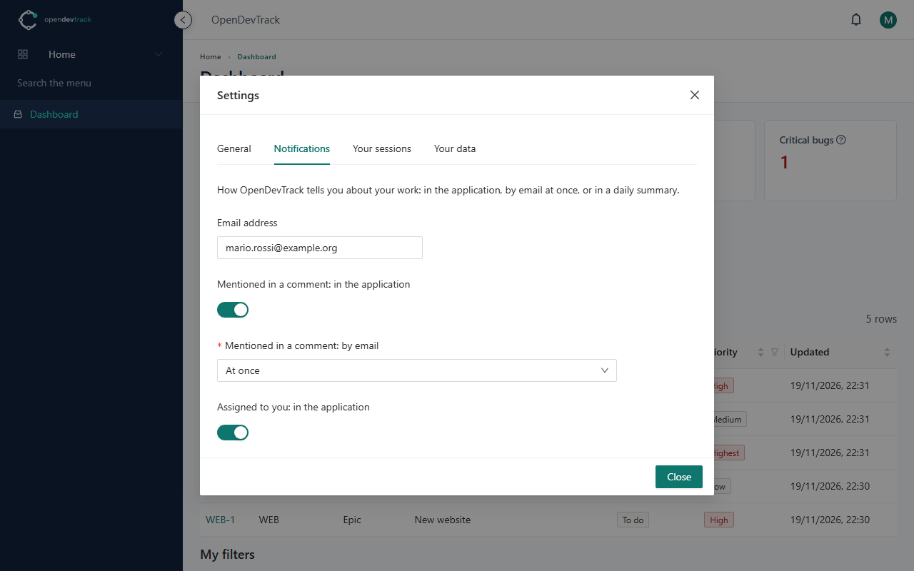

# Notifications

OpenDevTrack tells you about the work that concerns you: in the application, under the bell, and by email.

## What you are told

| Message | When |
| --- | --- |
| Mentioned in a comment | Someone writes `@your.name` in a comment ([Issues](issues.md#comments-and-mentions)) |
| An issue shared with you | Someone shares an issue with you, with or without a message ([Issues](issues.md)) |
| Assigned to you | You become the assignee of an issue |
| Asked to review | You become the reviewer of an issue |
| Comment on an issue you watch | Someone comments on an issue you watch |
| Status change of an issue you watch | An issue you watch changes its status |
| An issue you watch moved to another project | An issue you watch moves to another project you are a member of, with its new key |

Some rules:

- You are never told of what you did yourself.
- For one change you get one message, the most direct one. For example, a comment that mentions you is a mention,
  not also a comment on an issue you watch.
- You are told only about issues you can still see.

The admins of a project are also told when one of its webhooks is turned off after three days of failures
([The public API and webhooks](api.md#webhooks)).

## The bell

The bell at the top right shows your last 50 messages in the current tenant. It looks for new ones every minute.
Opening a message takes you to its issue. Messages are deleted after 90 days.

## Your choices

User menu › Settings › «Notifications» has two choices for each kind of message:

- **in the application**: on or off;
- **by email**: off, «At once», or «In the daily summary».

Until you choose, mentions, shared issues, assignments and reviews asked are mailed at once, and comments and status changes go in
the daily summary. A kind with both choices off is not recorded at all. A kind that is only by email does not show
under the bell.

The email address is the one of your account in the sign-in service, and it cannot be changed here. When the
installation sends no email, the screen says so and only the choices in the application apply.

## The mails

- A mail **at once** is sent within about a minute. It has the message and the link to the issue.
- The **daily summary** comes every morning (at 7:00 in the time zone of the installation, unless it is set otherwise)
  with what happened since the last one, in one mail.
- A message you read in the application before its summary is left out of it. So are the messages of a project you
  have left.

The mails are in the language you last used in the application. Their footer links to these settings.
