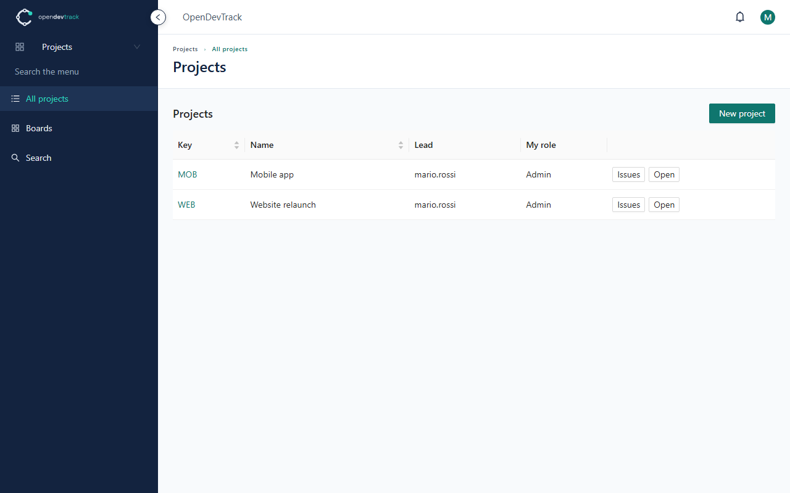
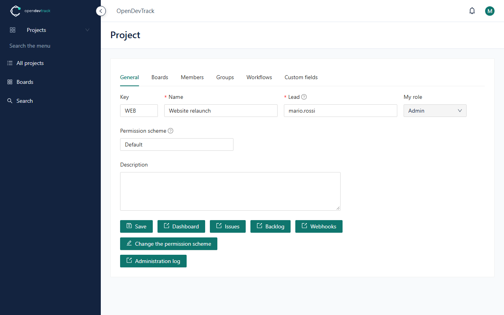

# Projects and members

A project holds issues, its members, its workflows, its boards and its sprints. Projects belong to a tenant: the
people of another tenant never see them.

## The projects

Projects › All projects lists the projects you are a member of, with your role in each one. «Issues» opens the issue
list of a project, and «Open» opens the project itself.

«New project» is shown to the users with the role «Project creator». A project needs:

- a **key** of 2 to 10 capital letters or digits, starting with a letter. It prefixes the issues (`WEB-42`), it is
  unique in the tenant, and it never changes;
- a **name**, and a description if you like.

Whoever creates a project becomes its lead and its admin.

## A project

The screen of a project is in tabs. **General** has its fields (name, lead, description, permission scheme) and the
buttons that lead to the rest:

- «Dashboard»: the charts of the project ([Dashboards and reports](dashboards.md));
- «Issues» and «Backlog»: the work ([Issues](issues.md), [Boards, backlog and sprints](boards.md));
- «Webhooks»: what other systems are told ([The public API and webhooks](api.md));
- «Change the permission scheme» and «Administration log»: who changed what in the configuration of the project, for
  its admins.

Each other tab is one part of the project, with the button that adds to it:

- **Boards**: «New board», then «Open», «Edit» and «Remove» on each one ([Boards](boards.md#boards));
- **Members** and **Groups**: below;
- **Workflows**: «New workflow», and «Open» on each one ([Workflows](workflows.md));
- **Custom fields**: «New field», and «Edit» on each one ([Issues](issues.md#custom-fields)).

The buttons that change the project are shown only to whoever may change it.

## Members and roles

Only the members of a project see its issues. Each member has a role:

| Role | What it gives, with the default permission scheme |
| --- | --- |
| Viewer | Sees the issues, their comments and attachments, the boards and the reports |
| Developer | Also creates and edits issues, changes their status, comments, attaches files and manages the sprints |
| Admin | Also deletes issues, moves them to another project, changes their reporter, edits the project (workflows, boards, custom fields, webhooks) and manages the members |

«Add member» picks a user of the tenant and a role. «Change role» and «Remove» are on each row. A project always keeps
at least one admin, so the last one cannot be removed or made a developer.

The users with the tenant role «Admin of the projects» are admins of every project of the tenant.

### Groups

A group is a named set of users of the tenant, made in Administration › Groups by an admin of the projects. A group
can be a member of a project with a role, under **Groups** («Add group»). Then each of its users has that role in the
project.

A user's role in a project is the highest of their own and of their groups. The column «Through groups» of the
members says which groups give it. Mentions, assignments and notifications are still per user.

### Permission schemes

What each role gives is a *permission scheme*. Every project starts with the default scheme of the tenant, in the
table above. The admins of the projects can change the default and add other schemes, in
Administration › Permission schemes.

The admin of a project picks one with «Change the permission scheme». Some rules hold in every scheme:

- every role sees the issues;
- the admin always edits the project and manages its members.

The permissions of a scheme are:

- see the issues;
- create issues, edit issues, delete issues, move issues to another project, change the reporter;
- change the status;
- comment, attach files;
- manage the sprints;
- edit the project, manage the members.

## The administration log

«Administration log» shows the last 500 changes to the configuration of the project: members, groups, the permission
scheme, workflows, boards, custom fields and webhooks. Each change has who made it, when, and the values before and
after. It is kept for two years. The work itself is not in it: issues, comments and sprints have their own history.
