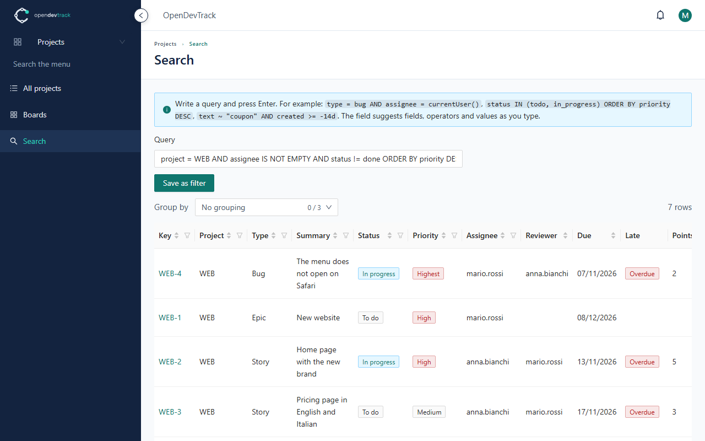

# Search and ODQL

Projects › Search finds issues across all your projects with a query in ODQL, the query language of OpenDevTrack.
The same language filters boards ([Boards](boards.md#boards)) and makes the saved filters of the dashboard
([Dashboards](dashboards.md)).

## The search screen



- **Query**: write a query and press Enter. As you type, the field suggests fields, operators and values (statuses,
  priorities, users, labels, sprints, projects). It checks the query, and when something is wrong it says where and
  what it expected.
- **The results**: the issues found, 100 at most per page. A key opens the issue. The headers sort and filter the
  results, and «Group by» groups them, on top of the query. The column «Sprint» shows the sprint of each issue, or
  «Backlog» for none; grouped by it, the sprints come in their order: active, planned, completed.
- **Save as filter**: keep the query with a name ([below](#saved-filters)).

A search finds only the issues of the projects you are a member of. The admins of the projects search all the
projects of the tenant. A query that names a project you cannot see finds nothing, without an error.

A search has its own address (`…/search?q=…`), so it can be shared as a link. From the issues of a project, «Open in
search» starts a search on that project.

## Saved filters

«Save as filter» asks for:

- a name;
- «Shared with everyone»: everyone in the tenant sees the filter, and each one finds only the issues they may see;
- «On my dashboard»: the filter shows on your dashboard with the number of issues it finds, up to 10 filters.

The table **Saved filters** has your filters and the shared ones: «Use» puts the query in the field, «Edit» changes
the name, the query and the choices, and «Remove» deletes the filter. Only the owner edits or removes a filter.

## ODQL

A query is a condition, then an optional order:

```
project = WEB AND status IN ("To do", in_progress) AND assignee = currentUser() ORDER BY rank
text ~ "coupon" AND priority >= high AND created >= -14d
labels = backend AND sprint IN openSprints() AND custom.customer = "ACME"
```

An empty query finds every issue. Without `ORDER BY`, the most recently updated issues come first. A query is at most
2000 characters long.

### Words and values

- The words of the language (`AND`, `OR`, `NOT`, `IN`, `IS`, `EMPTY`, `ORDER`, `BY`, `ASC`, `DESC`) and the names of
  the fields are read in any case: `and`, `And` and `AND` are the same.
- A value is a word (letters, digits and `_ . - + : @`) or a text in double quotes, needed for spaces:
  `"To do"`, `"Sprint 1"`. A `"` inside a text is written `\"`.
- The functions are `currentUser()`, the user who runs the query, `openSprints()`, the sprints not completed, and,
  for the type, `standardIssueTypes()` (task, bug, story, epic) and `subTaskIssueTypes()` (subtask), as in Jira.
- For the key, `linkedIssues(WEB-4)` gives the issues linked to WEB-4, and `linkedIssues(WEB-4, blocks)` those
  WEB-4 reads so: the issues it blocks. The relation is the one of the API, as WEB-4 reads it: `blocks`,
  `blocked_by`, `relates`, `duplicates`, `duplicated_by`, `clones`, `cloned_by`, and for a type the admin
  added its code, or `code:inward` from the other end (`causes`, `causes:inward`).

### Fields

| Field | What | Operators |
| --- | --- | --- |
| `project` | The key of the project: `WEB` | `= != IN NOT IN IS EMPTY` |
| `key` | The key of the issue: `WEB-4` | `= != IN NOT IN IS EMPTY` |
| `parent` | The key of the parent: `parent = WEB-1` finds the children of WEB-1 (also by a key it had before a move) | `= != IN NOT IN IS EMPTY` |
| `linked` | The key of an issue it is linked to, in any way: `linked = WEB-4`; `IS EMPTY` for the issues without links | `= != IN NOT IN IS EMPTY` |
| `linkType` | The code of the type of one of its links, from either end: `blocks`, `relates`, `duplicates`, `clones` and those the admin added | `= != IN NOT IN IS EMPTY` |
| `type` | `task`, `bug`, `story`, `epic`, `subtask`; with `IN` and `NOT IN` also `standardIssueTypes()` and `subTaskIssueTypes()` | `= != IN NOT IN IS EMPTY` |
| `status` | A status, by its code (`in_progress`) or its name in English or Italian (`"In progress"`, `"In corso"`) | `= != IN NOT IN IS EMPTY` |
| `category` | The category of the status: `todo`, `in_progress`, `done` | `= != IN NOT IN IS EMPTY` |
| `priority` | `lowest`, `low`, `medium`, `high`, `highest`, in this order | `= != < <= > >= IN NOT IN` |
| `assignee` | A user name, or `currentUser()` | `= != IN NOT IN IS EMPTY` |
| `reviewer` | A user name, or `currentUser()` | `= != IN NOT IN IS EMPTY` |
| `team` | A team of the workspace, by its name | `= != IN NOT IN IS EMPTY` |
| `reporter` | A user name, or `currentUser()` | `= != IN NOT IN IS EMPTY` |
| `labels` | One of the labels of the issue | `= != IN NOT IN IS EMPTY` |
| `flagged` | `Impediment` when the issue is flagged, as in Jira, else empty | `= != IN NOT IN IS EMPTY` |
| `summary` | The summary | `~ !~ = !=` |
| `text` | The words of the summary, the description and the labels | `~ !~` |
| `created` | The day it was created | `= != < <= > >= IS EMPTY` |
| `updated` | The day it last changed | `= != < <= > >= IS EMPTY` |
| `resolved` | The day its status reached the category Done | `= != < <= > >= IS EMPTY` |
| `start` | Its start date | `= != < <= > >= IS EMPTY` |
| `due` | Its due date | `= != < <= > >= IS EMPTY` |
| `sprint` | A sprint, by its name, or `openSprints()` | `= != IN NOT IN IS EMPTY` |
| `points` | The story points, a whole number | `= != < <= > >= IN NOT IN IS EMPTY` |
| `originalEstimate` | The original estimate, a duration | `= != < <= > >= IS EMPTY` |
| `remainingEstimate` | The remaining estimate, a duration | `= != < <= > >= IS EMPTY` |
| `timeSpent` | The time logged, a duration (`0m` when none) | `= != < <= > >= IS EMPTY` |
| `custom.<key>` | A custom field of the project, by its key ([Issues](issues.md#custom-fields)) | `= != < <= > >= ~ !~ IN NOT IN IS EMPTY` |
| `rank` | The order of the project, only in `ORDER BY` | |

`IS NOT EMPTY` is allowed wherever `IS EMPTY` is.

### Operators

| Operator | Meaning |
| --- | --- |
| `=`, `!=` | Equal, not equal |
| `<`, `<=`, `>`, `>=` | Before or after for dates, less or more for numbers and priorities |
| `IN (a, b)`, `NOT IN (a, b)` | One of the values, none of them. `sprint IN openSprints()` and `key IN linkedIssues(WEB-4)` take the function without parentheses around it |
| `~`, `!~` | Contains, does not contain (below) |
| `IS EMPTY`, `IS NOT EMPTY` | Has no value, has one. For `labels`: has no label, has some |
| `AND`, `OR`, `NOT`, `( )` | `NOT` binds first, then `AND`, then `OR`. Parentheses change it |

What `~` finds depends on the field:

- `summary ~ safari` finds the summaries that contain that text anywhere, without regard to case or accents.
- `text ~ "menu safari"` finds the issues whose summary, description or labels have every word, each as the start of
  a word: `menu` also finds `menus`.
- `custom.<key> ~ …` finds the values that contain the text.

### Dates

`created`, `updated`, `resolved`, `start` and `due` take a day:

- a date: `2026-11-07`;
- `today`;
- a number of days, weeks, months or years from today: `-14d`, `-2w`, `-1m`, `-1y`, or `+3d` in the future.

A day is the whole day in the time zone of the installation: `created = today` finds what was created today, and
`created >= -7d` what was created in the last seven days, today included. `due < today AND category != done` finds the
issues past their due date.

### Durations

`originalEstimate`, `remainingEstimate` and `timeSpent` take a duration as the issue writes it, `1w 2d 3h 30m`, in
quotes when it has more than one part: `timeSpent > 4h`, `originalEstimate >= "1d 4h"`; a bare number is minutes.
A day and a week are as long as in the installation (8 hours and 5 days unless it says otherwise).
`remainingEstimate = 0` finds the issues with nothing left, `originalEstimate IS EMPTY` those not estimated.

### Order

`ORDER BY` takes one or more fields, each with `ASC` (the default) or `DESC`, separated by commas:

```
ORDER BY priority DESC, due ASC
```

The fields are `project`, `key`, `type`, `status`, `category`, `priority`, `assignee`, `reviewer`, `reporter`,
`summary`, `created`, `updated`, `resolved`, `start`, `due`, `points`, `originalEstimate`, `remainingEstimate`,
`timeSpent`, `rank` and `custom.<key>`. Empty values come last.
`project` and `key` order by project, then by number, so `WEB-10` comes after `WEB-9`. `rank` is the order of the
project, the one of the backlog.

### Custom fields

`custom.<key>` compares the value of the field as text, or as a number when the value is a number:

```
custom.customer = "ACME"
custom.estimate_days > 3
custom.platforms IN (ios, android)
custom.due_review <= 2026-12-31
```

A field with several choices matches when one of its choices is the value, as `labels` does: `custom.platforms = ios`
finds the issues with iOS among their platforms, and `!=` those without it. A date is compared as text, which keeps
the order of dates written as `2026-12-31`.

### Examples

| Query | Finds |
| --- | --- |
| `assignee = currentUser() AND category != done` | Your open issues |
| `reviewer = currentUser() AND status = in_progress` | What waits for your review |
| `type = bug AND priority >= high AND resolved IS EMPTY` | Open bugs of high and highest priority |
| `project = WEB AND sprint IN openSprints() ORDER BY rank` | The planned work of WEB, in its order |
| `project = WEB AND type IN subTaskIssueTypes() AND assignee = currentUser()` | My subtasks in WEB |
| `labels IN (frontend, i18n) AND updated >= -7d` | Front-end and translation work of the last week |
| `text ~ "safari menu" OR summary ~ safari` | Anything about the menu on Safari |
| `due <= +7d AND category != done ORDER BY due` | What is due within a week |
| `labels IS EMPTY AND created >= -30d` | Recent issues without labels |
| `NOT (type = epic OR category = done)` | Everything open but the epics |
| `parent = WEB-1 AND category != done` | The open children of WEB-1 |
| `type = story AND parent IS EMPTY` | The stories in no epic |
| `key IN linkedIssues(WEB-4, blocked_by) AND category != done` | What still blocks WEB-4 |
| `linkType = duplicates AND category != done` | Open issues with a duplicate |

### Errors

A query that is not right is not run. The field says where it is wrong, counting characters from 1, and what was
expected there, for example `priority = urgent` gives `Not right at position 12: Unknown priority 'urgent'`. The
messages of the language are in English, in every language of the screens.
