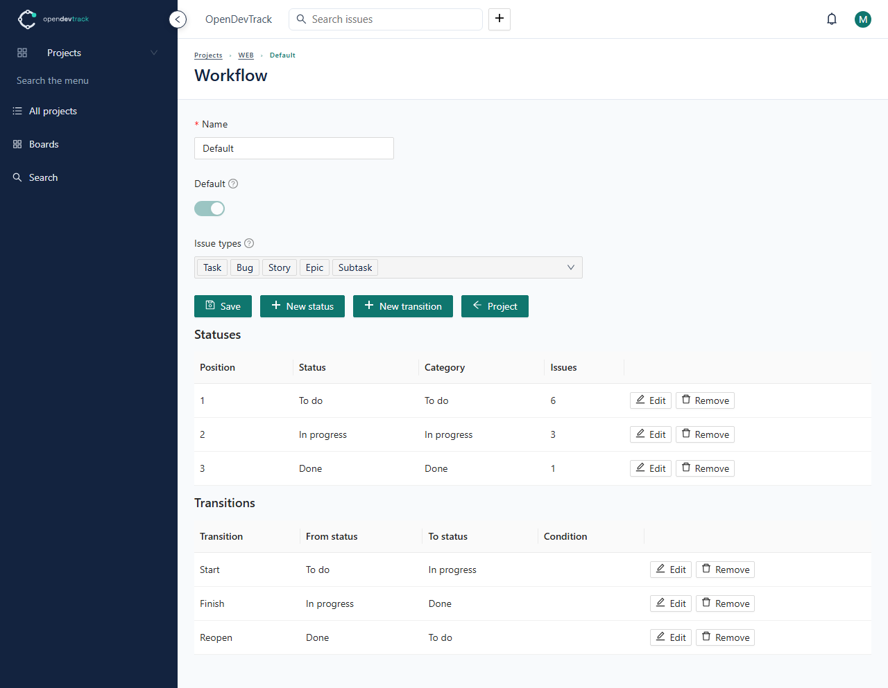

# Workflows

A workflow is the set of statuses an issue goes through, and the transitions that lead from one to another. The status
of an issue changes only through a transition: from the status button of the issue, or by moving its card on a board.

## The default workflow

Every project starts with a copy of the built-in workflow:

| Transition | From | To |
| --- | --- | --- |
| Start | To do | In progress |
| Finish | In progress | Done |
| Reopen | Done | To do |

Each project changes its own copy, and the other projects are not affected.

## Editing a workflow



The admins of a project open a workflow from the table **Workflows** of the project («Open»).

### Statuses

- **Code**: lower-case letters, digits and `_`, from a letter. It never changes. The built-in statuses are shown by
  their name in the language of the user, and the others by their code.
- **Category**: To do, In progress or Done. Boards, reports and the search group statuses by category: an issue is
  resolved when its status is in the category Done.
- **Position**: the order of the statuses, from 1.

Some rules keep a workflow usable:

- the first status, where new issues start, is in the category To do;
- each category keeps at least one status;
- a code has the same category in every workflow of the project.

«New status» adds one, last when its position is empty. «Remove» on a status asks where its issues go. They move
there, each move recorded in their history, and the transitions from or to that status are removed.

### Transitions

A transition has a code, a status it starts from, and the status it leads to. Its «From status» may be empty: then it
starts from every status. A transition may also have a condition (below).

«New transition» adds one. «Edit» changes its statuses and its condition, and «Remove» takes it away. The issues stay
where they are.

### Conditions

A condition decides whether a transition can run now. It is an expression in CEL (Common Expression Language) on two
variables:

- `issue`: the fields of the issue: `key`, `project`, `type`, `summary`, `description`, `status`, `priority`,
  `assignee`, `reporter`, `reviewer`, `dueOn` (a date as text, `2026-11-30`), `labels`, and `custom.<key>` for the
  custom fields. Codes are in lower case (`bug`, `highest`), and an empty field is `null`;
- `user`: who runs it, with `username` and `roles`.

The function `can('<permission>')` asks whether the user holds a permission in the project. Some examples:

```
issue.assignee != null
issue.reviewer != null && user.username == issue.reviewer
can('odt.issue.delete')
issue.type != "bug" || "regression" in issue.labels
```

The condition is checked when it is saved, so a mistake is found at once. A condition that fails while it runs counts
as false. A transition whose condition is false is not offered in the menu of the status button, and a card moved on a board with only
such transitions goes back.

The permissions are:

| Permission | Lets you |
| --- | --- |
| `odt.issue.browse` | see the issues |
| `odt.issue.create` | create issues |
| `odt.issue.edit` | edit issues |
| `odt.issue.transition` | change the status |
| `odt.issue.comment` | comment |
| `odt.issue.attach` | attach files |
| `odt.issue.delete` | delete issues |
| `odt.reporter.edit` | change the reporter of an issue |
| `odt.sprint.manage` | manage the sprints |
| `odt.project.edit` | edit the project |
| `odt.member.manage` | manage the members |

## Several workflows in a project

A project may give each issue type its own workflow: bugs through a triage, for example, and the other types through
the default one.

- «New workflow» in the project makes a copy of the default workflow, with a name.
- In the new workflow, «Issue types» picks the types it serves, and «Save» saves the name and the types together.
- The types that no other workflow takes follow the default one, so its types cannot be changed by hand.

When a type moves to another workflow, its issues keep their status if the new workflow has it. Otherwise they move
to its first status of the same category. The same happens when the type of an issue is changed.

A workflow that serves no type can be removed. The default one cannot.

The workflow screen shows how many issues each status holds. When someone else changed the workflow in the meantime,
saving says so: reload it and make the change again.
