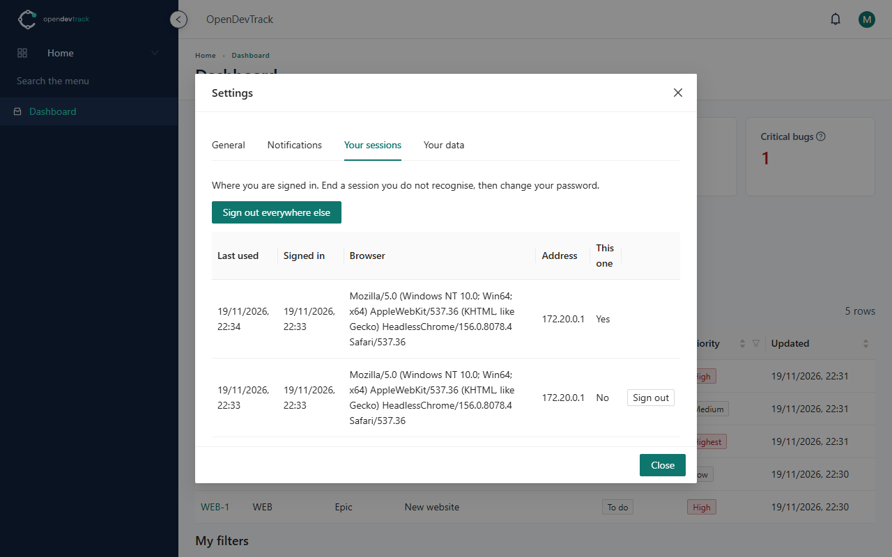
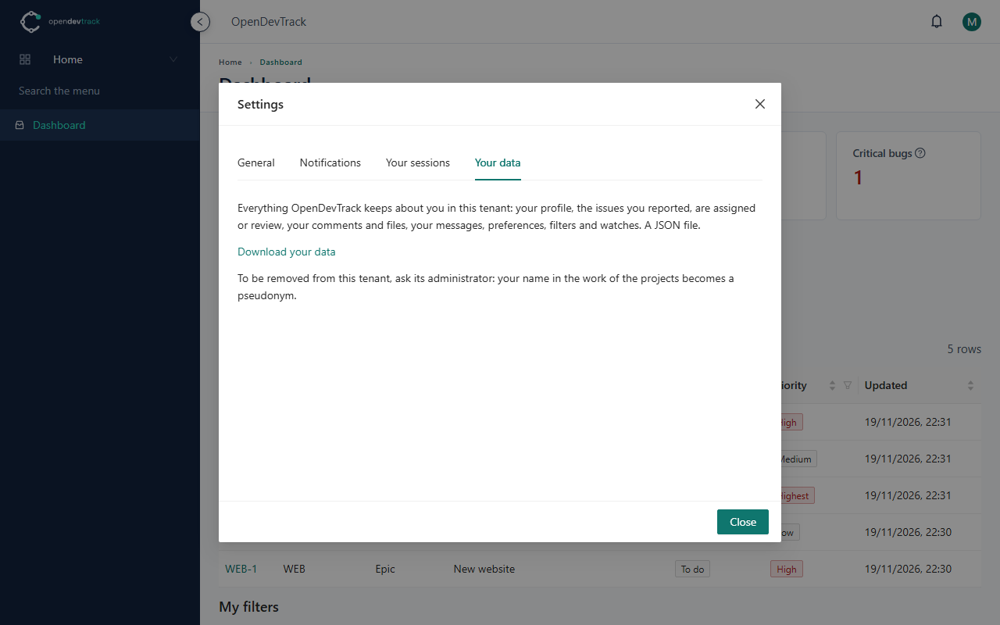

# Your data and your sessions

Two tabs of User menu › Settings are about you: where you are signed in, and what OpenDevTrack keeps about you.

## Your sessions

«Your sessions» lists where you are signed in, in the current tenant: when each session started and was last used,
the browser and the address it came from. «This one» marks the browser you are using.

- «Sign out» on a row ends that session. Whoever is using it has to sign in again.
- «Sign out everywhere else» ends every session but this one.

If you see a session you do not recognise, end it, then change your password in the sign-in service.

Signing out from the user menu ends this session. Signing out of the sign-in service ends the sessions of
OpenDevTrack that depend on it too.

## Your data

«Download your data» gives you, as one JSON file, everything OpenDevTrack keeps about you in this tenant:

- your profile;
- the issues you reported, are assigned or review;
- your comments and your files;
- your messages, your notification choices, your saved filters and what you watch.

To be removed from a tenant, ask its administrator. Then your name in the issues, comments and histories of its
projects becomes a pseudonym. Your messages, choices, filters, watches and memberships are deleted. What you wrote
stays, so that the history of the work still makes sense. Your account in the sign-in service is separate: the
administrator deletes it there.
